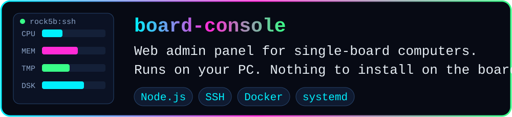
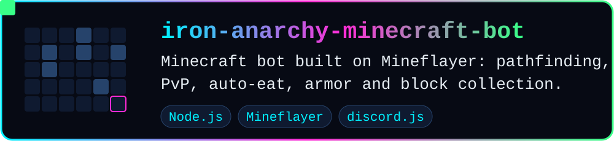

  

  
  
  

Hi, I'm **Local Acct**. I've worked in IT for over 25 years, across Windows and Linux servers and networking, and I previously worked at CISA in fraud detection. These days I do private IT work in the southwest Virginia area, and most of what I build here comes out of looking after my own machines. I also used to run Minecraft servers, which is where the bot below came from.

## ⚡ Projects

Live metrics, browser terminals, services, Docker, logs, files, updates and power control. Built for a Raspberry Pi and a Radxa Rock 5B. **[View board-console →](https://github.com/Localacct21/board-console)**

Includes a Discord integration and a web inventory view. **[View the bot →](https://github.com/Localacct21/iron-anarchy-minecraft-bot)** 

The rate, port and output file are configurable. **[View the scanner →](https://github.com/Localacct21/Simple-Global-Minecraft-Scanner)**

## 🧰 Tools I use

  

## 📡 Also on my radar

<b>Forks I keep around, mostly software-defined radio</b>

- [HackRF-Treasure-Chest-Repo](https://github.com/Localacct21/HackRF-Treasure-Chest-Repo): HackRF software and captures
- [antsdr-fw](https://github.com/Localacct21/antsdr-fw): ANTSDR firmware
- [LimeSDR-USB](https://github.com/Localacct21/LimeSDR-USB): the USB 3.0 LimeSDR board
- [firmware-open](https://github.com/Localacct21/firmware-open): System76 open firmware
- [AnarchyExploitFixes](https://github.com/Localacct21/AnarchyExploitFixes): exploit fixes for anarchy Minecraft servers

## 💬 Get in touch

Open an issue on any of the repos above.

  

