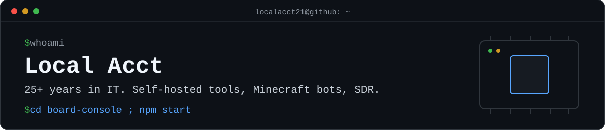

  

Hi, I'm Local Acct, based in North Carolina. I've worked in IT for over 25 years, across Windows and Linux servers, networking, and Minecraft and CS2 game servers. Most of what I build here comes out of looking after my own machines.

## Projects

### [board-console](https://github.com/Localacct21/board-console)

A self-hosted web admin panel for single-board computers. It runs on your PC and manages each board over SSH, so nothing gets installed on the boards. I built it for a Raspberry Pi and a Radxa Rock 5B, and it works with other Debian-style boards that use systemd.

Live metrics, browser terminals, systemd services, Docker, logs, files, package updates and power control.

`JavaScript` `Node.js` `SSH` · MIT

### [iron-anarchy-minecraft-bot](https://github.com/Localacct21/iron-anarchy-minecraft-bot)

A Minecraft bot for the Iron-Anarchy server, built on Mineflayer. It handles pathfinding, PvP, auto-eating, armor and block collection, with a Discord integration and a web inventory view.

`JavaScript` `Node.js` `Mineflayer` `discord.js` · MIT

### [Simple-Global-Minecraft-Scanner](https://github.com/Localacct21/Simple-Global-Minecraft-Scanner)

A small shell script that uses Masscan to look for Minecraft servers across public IPv4, with optional Nmap and Netcat checks afterwards. The rate, port and output file are configurable.

`Bash` `Masscan` · MIT

## Also on my radar

Forks I keep around, mostly software-defined radio:

- [HackRF-Treasure-Chest-Repo](https://github.com/Localacct21/HackRF-Treasure-Chest-Repo): HackRF software and captures
- [antsdr-fw](https://github.com/Localacct21/antsdr-fw): ANTSDR firmware
- [LimeSDR-USB](https://github.com/Localacct21/LimeSDR-USB): the USB 3.0 LimeSDR board
- [firmware-open](https://github.com/Localacct21/firmware-open): System76 open firmware
- [AnarchyExploitFixes](https://github.com/Localacct21/AnarchyExploitFixes): exploit fixes for anarchy Minecraft servers

## Get in touch

Open an issue on any of the repos above.
